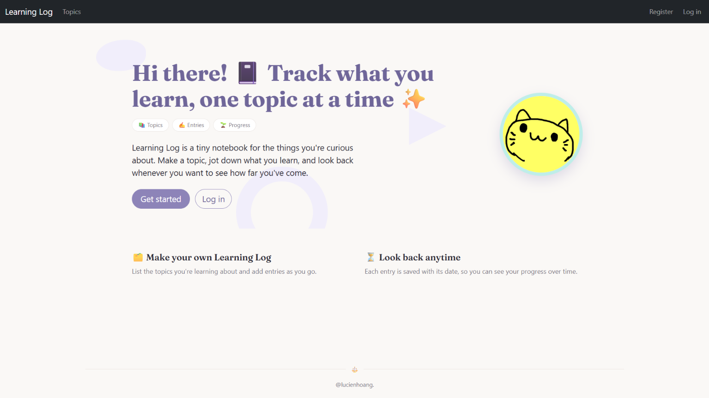
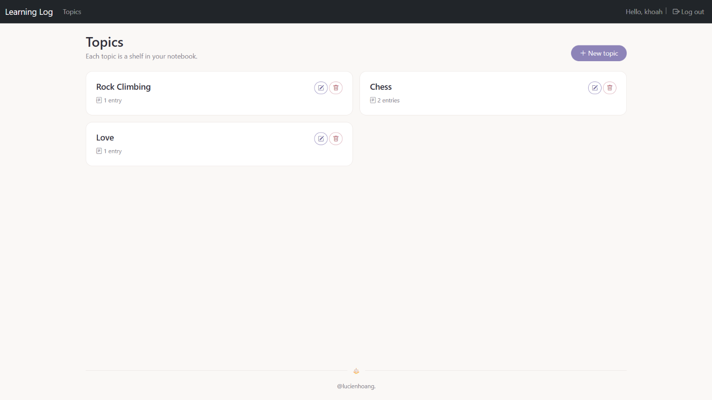
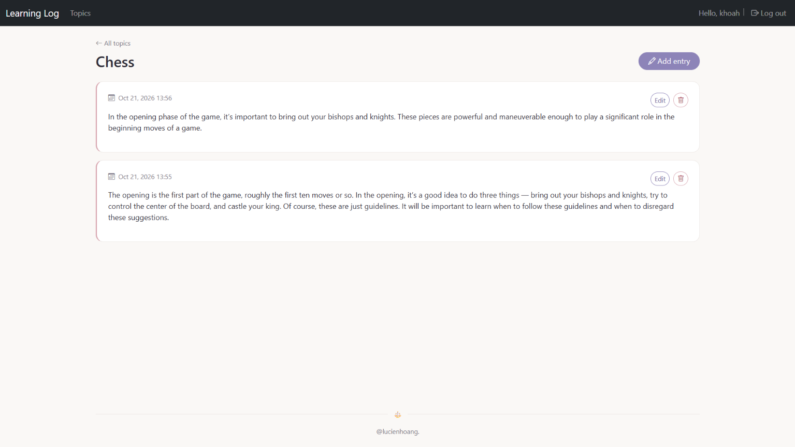
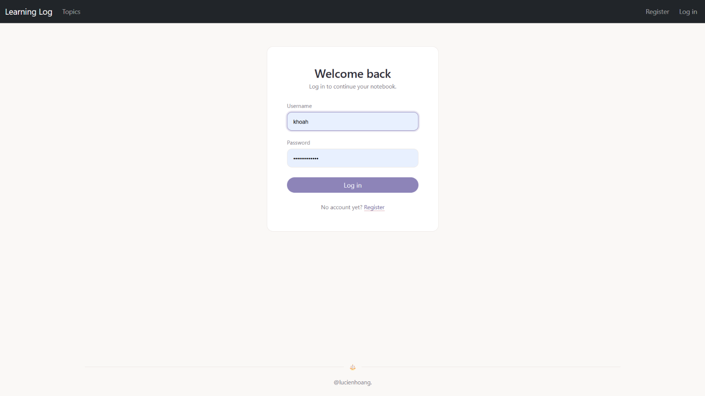
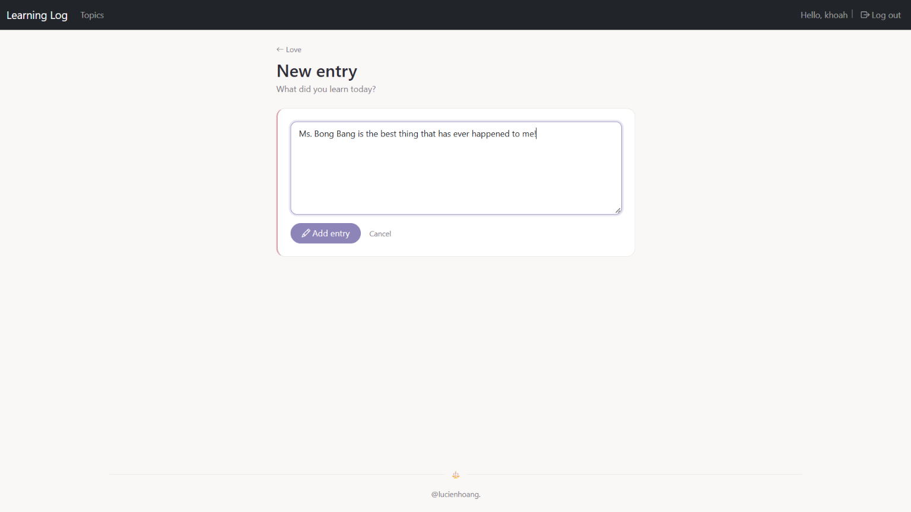
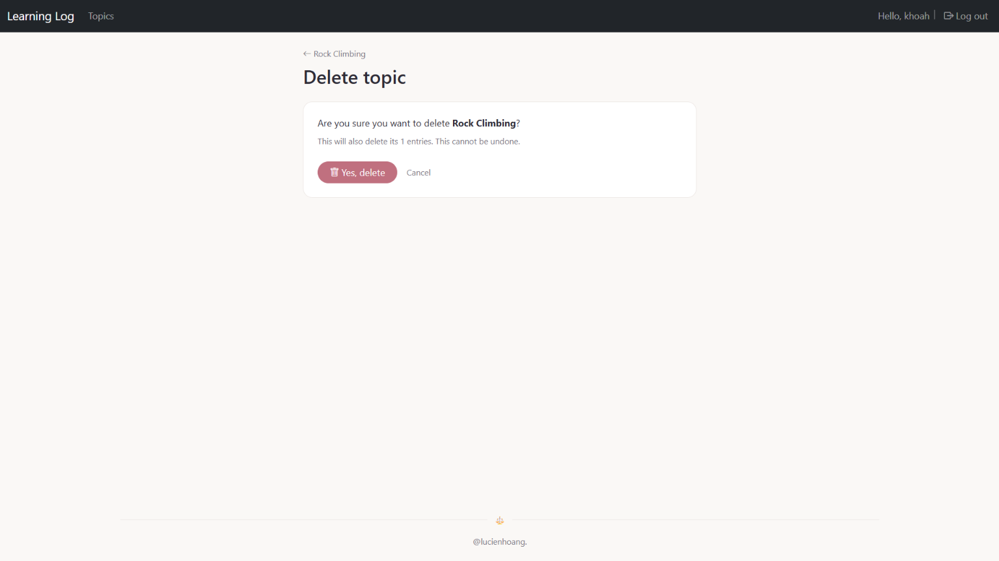

# Learning Log

A small journaling web app for keeping track of what you learn, one topic at a time.
Create topics, write entries under them, and look back whenever you want to see how far you've come.

Built with Django while following _Python Crash Course_ (2nd edition, Project 3), then extended with
extra features and a full restyle using **Bootstrap 5**.

## Screenshots

| Home                               | Topics                                 |
| ---------------------------------- | -------------------------------------- |
|  |  |

| Topic & entries                      | Log in                               |
| ------------------------------------ | ------------------------------------ |
|  |  |

| New entry                                    | Delete confirmation                                        |
| -------------------------------------------- | ---------------------------------------------------------- |
|  |  |

## Features

- **User accounts**: register, log in and log out. Each user only sees their own data.
- **Topics**: create, rename and delete topics.
- **Entries**: add, edit and delete entries inside a topic, each saved with its date.
- **Safe deletion**: deleting a topic or entry goes through a confirmation page and only happens on `POST`.
- **Access control**: pages require login, and users cannot open or modify other users' topics by guessing URLs.
- **Responsive design**: works on desktop and mobile, with a collapsing navbar.

## Beyond the book

The book covers topics, entries, and user accounts. This version adds:

- Rename topic and delete topic / delete entry, with confirmation pages
- Modern Django syntax (`path()`, `LoginView`, `get_object_or_404`, `redirect`) instead of the book's Django 2.0 code
- A complete UI restyle with **Bootstrap 5** instead of the book's Bootstrap 3
- A custom pastel theme (lavender and rose on a cream background) with its own stylesheet
- Bootstrap Icons, the Fraunces font for headings, and a sticky footer
- Styled login and register forms, with inline error messages
- Entry counts on each topic card, with correct singular / plural wording

## Tech stack

- Python 3 and Django
- SQLite (default Django database)
- Bootstrap 5.3 and Bootstrap Icons (loaded from a CDN)
- Google Fonts (Fraunces)

## Getting started

```bash
# 1. Clone the repository
git clone https://github.com/<your-username>/<your-repo>.git
cd <your-repo>/<path-to-folder-containing-manage.py>

# 2. Create and activate a virtual environment
python -m venv ll_env
ll_env\Scripts\activate        # Windows
# source ll_env/bin/activate   # macOS / Linux

# 3. Install dependencies
pip install django

# 4. Set up the database
python manage.py migrate

# 5. (Optional) Create an admin user
python manage.py createsuperuser

# 6. Run the development server
python manage.py runserver
```

Then open <http://127.0.0.1:8000/> in your browser.

## Project structure

```
learning_log/
├── learning_log/        # Project settings and root URLs
├── learning_logs/       # Main app: topics and entries
│   ├── static/learning_logs/style.css
│   └── templates/learning_logs/
├── users/               # Registration, login, logout
│   └── templates/users/
└── manage.py
```

## Main routes

| URL                                 | Description                                  |
| ----------------------------------- | -------------------------------------------- |
| `/`                                 | Home page                                    |
| `/topics/`                          | List all your topics, with rename and delete |
| `/topics/<id>/`                     | A topic and its entries                      |
| `/new_topic/`                       | Create a topic                               |
| `/edit_topic/<id>/`                 | Rename a topic                               |
| `/delete_topic/<id>/`               | Confirm and delete a topic                   |
| `/new_entry/<id>/`                  | Add an entry to a topic                      |
| `/edit_entry/<id>/`                 | Edit an entry                                |
| `/delete_entry/<id>/`               | Confirm and delete an entry                  |
| `/users/login/`, `/users/register/` | Log in and register                          |

## What I learned

- How Django's URL routing, views and templates connect, including how `topic_id` travels from a link to a view
- Using `ModelForm`, `commit=False`, and `instance=` to create and update records
- Protecting user data with `login_required` and ownership checks
- Replacing outdated book code with current Django and Bootstrap 5 equivalents
- Structuring a small design system with CSS variables on top of Bootstrap utilities

## Acknowledgements

Based on the Learning Log project from _Python Crash Course_ by Eric Matthes.
